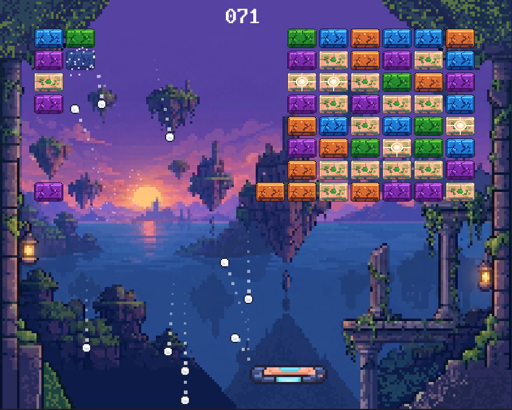
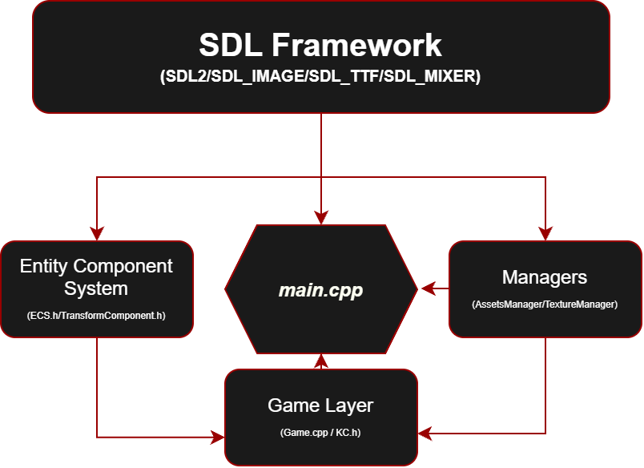
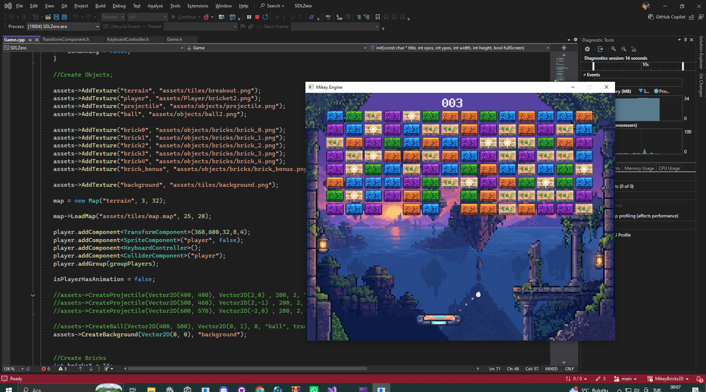
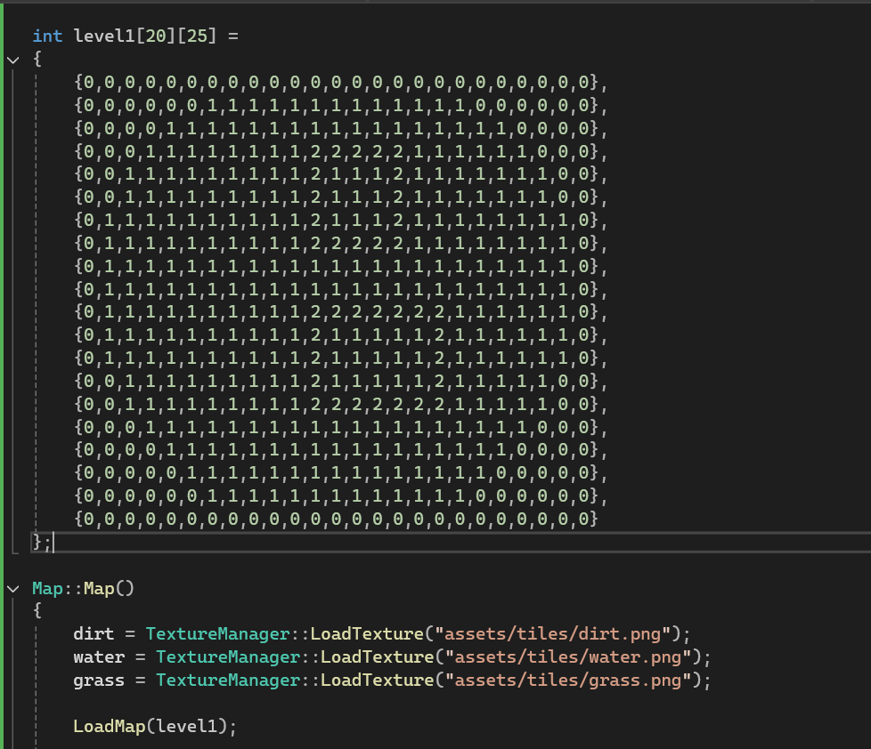

Mikey Engine is a lightweight 2D game engine developed from scratch in C++ using SDL2. Built around an Entity Component System (ECS) architecture, it provides the essential systems required to develop 2D games, including rendering, entity management, collision detection, tile maps, audio, text rendering, and particle effects.

The primary goal of the project was to create a reusable game development framework rather than a standalone game. By separating the engine's core systems from game-specific logic, Mikey Engine allows developers to build their own games on top of the existing infrastructure without having to implement fundamental functionality from scratch.

The engine features a modular ECS architecture in which entities are constructed by attaching independent components such as TransformComponent, SpriteComponent, and ColliderComponent. This approach makes game objects flexible and allows new behaviours to be introduced through custom components without modifying the underlying engine architecture.

Core Architecture

The engine is organized into several independent systems, each responsible for a specific part of the game development pipeline. The ECS manages entities, components, and entity groups, while the engine layer provides shared functionality such as collision detection, vector mathematics, animation, and particle handling.

Key Features

* Entity Component System (ECS) for modular game object construction.
* Entity grouping for organizing and managing different object categories.
* Sprite rendering with sprite-sheet animation, flipping, and fade-out effects.
* AABB collision detection through reusable collider components.
* Tile map loading with separate visual and collision layers.
* Centralized asset management for textures and resources.
* Audio playback using SDL_mixer.
* Text rendering using SDL_ttf.
* Particle emission and trail effects.
* Fixed 60 FPS game loop with frame delta time.
* Debug mode with visual collider rendering.
* Extensible component architecture for implementing custom game mechanics.

Technical Details

Game Engine: Mikey Engine (Custom)

Programming Language: C++14/17

Multimedia Library: SDL2

Image Processing: SDL2_image

Audio: SDL2_mixer

Text Rendering: SDL2_ttf

Architecture: Entity Component System (ECS)

Rendering: 2D Sprite Rendering

Collision System: Axis-Aligned Bounding Box (AABB)

Animation: Sprite-Sheet Animation

Particle System: Custom Particle and Trail Components

Frame Rate: Fixed 60 FPS

Platform: Windows

Project Type: Custom Game Engine Development

Core Logic: Entity management, component-based architecture, rendering, collision detection, resource management, and real-time game loop execution.

